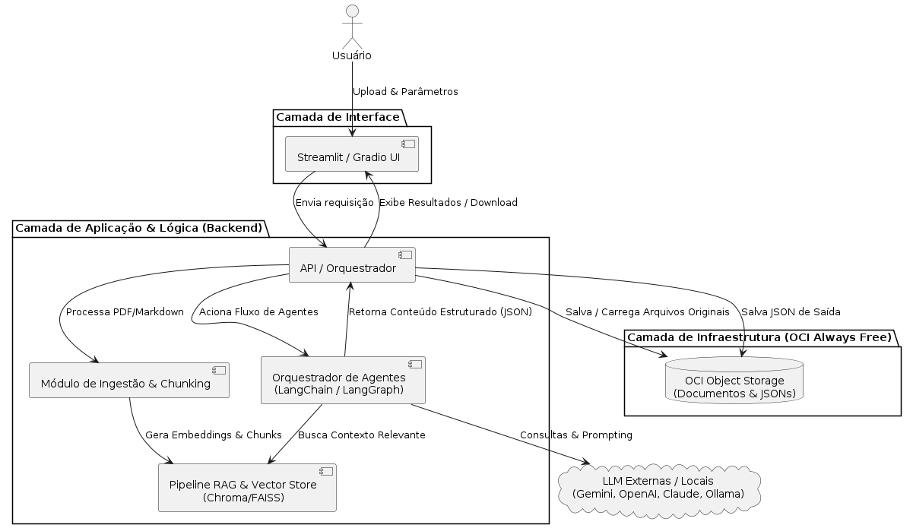
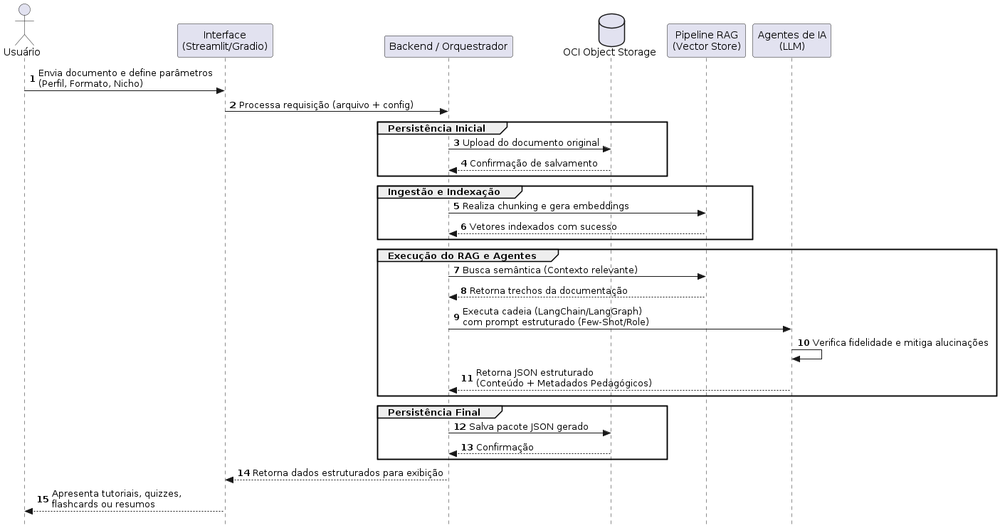

# G10_BRASIL_equipo16_NovaMente
Sistema Inteligente de Adaptação e Geração de Conteúdo Educacional.

# O que é o NovaMente?

O NovaMente é uma plataforma que recebe documentação técnica em PDF, Markdown ou texto simples e a transforma automaticamente em material educacional adaptado ao perfil do destinatário, ao contexto temático e ao nível de profundidade exigido.

O sistema combina recuperação aumentada por geração (RAG), busca vetorial e geração assistida por modelos de linguagem para trabalhar sempre a partir do documento original.

O objetivo é reduzir o tempo necessário para converter documentação técnica complexa em material de estudo, mantendo dois princípios centrais:

* fidelidade à fonte, utilizando como contexto os fragmentos recuperados do documento original;
* adaptação pedagógica, ajustando a linguagem, o nível de profundidade e a apresentação ao perfil solicitado.

O escopo funcional das features extras concentra-se em dois formatos educacionais:

* Quiz interativo, com opções, resposta correta e justificativa;
* Flashcards, com conceito ou pergunta e sua explicação correspondente.

Outros formatos contemplados pelo produto, como tutoriais e resumos, fazem parte de iterações posteriores.

# Estrutura deste repositorio

```bash

$ tree
.
├── docs
├── LICENSE
├── out
├── README.md
└── src                         # raiz do app
    ├── agent_pipeline.py
    ├── app.py
    ├── chroma_temp_db
    ├── env_template
    ├── exemplo_documento.pdf
    ├── main.py
    ├── pyproject.toml
    ├── rag_pipeline.py
    ├── README.md
    ├── temp_data
    └── uv.lock

```

---

### Arquitetura da solucao:


### Sequencia de interacoes:


---

## Roteiro de Desenvolvimento Planejado
```

[Etapa 1: Ingestão & RAG] ➔ [Etapa 2: Agentes & Prompts] ➔ [Etapa 3: Backend & Schema JSON]
                                                                      │
[Etapa 5: OCI & Documentação] ◄───────── [Etapa 4: Interface UI] ◄────┘

```

---

# Antes de comecar:
Todos os contribuintes devem clonar este repositório e evitar de escrever direto na branch `main`, para cada contribuicao individual o desenvolvedor deve criar uma branch propria, ex:

```bash

git checkout -b "dev-$USER"

```
 Após ter feito mudancas o codigo deve passar por um review coletivo para entao ser unido a branch `main`.

# Instalar e executar o projeto localmente

Este projeto utiliza a ferramenta ""[UV](https://docs.astral.sh/uv/)"" para gerenciar todas as suas dependencias e pacotes, certifique-se de ter o UV instalado antes de comecar.

### Instalar o UV

Documentacao oficial: "[Installing uv](https://docs.astral.sh/uv/getting-started/installation/)"

#### Linux && macOs
```bash

curl -LsSf https://astral.sh/uv/install.sh | sh

```

#### windows
Use `irm` to download the script and execute it with iex:

```powershell

powershell -ExecutionPolicy ByPass -c "irm https://astral.sh/uv/install.ps1 | iex"

```

### Instalar as dependencias

A partir da raiz deste repositorio, navegue até o diretorio raiz do APP:

```bash

cd src

```

Utilize a ferramneta `uv` para instalar as dependencias:

```bash

uv sync

```

Execute o APP com o comando:

```bash

uv run streamlit run app.py

```

O app deve abrir automaticamente no seu navegador no endereco `http://localhost:8501/`

# Configurar Chaves API e variaveis de ambiente

Para executar o projeto localmente voce deverá fornecer as suas chaves de api pelas variaveis de ambiente, na raiz do app existe um arquivo `env_template` para ser usado como guia de configuracao.

Crie um arquivo `.env` no diretório do APP em:

```bash

src/.env

```

este arquivo deve conter as seguintes chaves:

```toml

GOOGLE_CLIENT_ID="seu-client-id-aqui.apps.googleusercontent.com"
GOOGLE_CLIENT_SECRET="seu-client-secret-aqui"
GOOGLE_API_KEY="sua_chave_do_gemini_aqui"

```

#### Configure também as chaves do streamlit 

Essas chaves sao necessarias para utilizar a api the autenticacao.

Crie o arquivo em:

```bash

src/.streamlit/secrets.toml

```

o arquivo deve conter:

```toml

[auth]
redirect_uri = "http://localhost:8501/oauth2callback"
cookie_secret = "uma_chave_secreta_bem_longa_e_aleatoria_aqui"
client_id = "sua_chave_google_aqui.googleusercontent.com"
client_secret = "seu_google_secret_aqui"
server_metadata_url = "https://accounts.google.com/.well-known/openid-configuration"

```

---

### 1. Etapa 1: Fundação do RAG (Ingestão e Busca Semântica)

~~> **Objetivo:** Garantir que o sistema consiga ler arquivos técnicos e buscar informações relevantes sem erros.~~

* [✔] **Configurar o ambiente Python:** Crie um ambiente virtual (`venv` ou `conda`) e instale bibliotecas base (`langchain`, `pypdf`, `chromadb` ou `faiss-cpu`, `sentence-transformers`).
* [✔] **Leitura de documentos:** Crie um script/módulo simples para ler arquivos `.pdf`, `.md` e `.txt` usando `PyPDF` ou carregadores nativos do LangChain.
* [✔] **Chunking & Embeddings:**
* Divida o texto em pedaços com `RecursiveCharacterTextSplitter` (ex: tamanho de chunk ~1000 com overlap de ~200).
* Escolha um modelo de embeddings (ex: OpenAI `text-embedding-3-small` ou HuggingFace `all-MiniLM-L6-v2` gratuito/local).~~


* [✔] **Vector Store:** Guarde os vetores em um banco de vetores local como **ChromaDB** ou **FAISS**.
* [✔] **Validação inicial:** Teste uma pergunta sobre o documento e verifique se os trechos recuperados (*retrieval*) são exatos e relevantes.

---

### 2. Etapa 2: Orquestração de Agentes e Prompts

> **Objetivo:** Desenvolver o fluxo de inteligência adaptativa (perfil, nicho, formato pedagógico e prevenção de alucinações).

* [✔] **Configurar conexão com LLM:** Escolha a API base (Google Gemini, OpenAI GPT-4o, Claude ou Ollama local).
* [✔] **Engenharia de Prompts:** Crie templates dinâmicos (*Role Prompting*) que recebam:
* `Perfil`: ex.: *Líder Técnico* vs. *Iniciante*.
* `Nicho`: ex.: *Fintech*, *Saúde*.
* `Formato`: ex.: *Quiz*, *Flashcards*, *Tutorial*.


* [✔] **Cadeia de Geração e Revisão (LangChain / LangGraph):**
* **Agente 1 (Redator):** Lê o contexto RAG e gera o conteúdo pedagógico.
* **Agente 2 (Revisor/Validador):** Verifica se o conteúdo gerado é fiel ao texto original e se condiz com o perfil solicitado.


* [✔] **Extração de Metadados:** Peça para a LLM gerar também pré-requisitos, tempo estimado de estudo e termos-chave.

---

### 3. Etapa 3: Estruturação dos Dados (JSON & Schemas)

> **Objetivo:** Garantir que o resultado final seja previsível e padronizado para integração.

* [✔] **Definir o Schema com Pydantic:**
Crie um modelo estrito de dados em Python:
```python
from pydantic import BaseModel
from typing import List

class ConteudoEducacional(BaseModel):
    titulo: str
    perfil_destinatario: str
    tempo_estimado_minutos: int
    conceitos_chave: List[str]
    pre_requisitos: List[str]
    conteudo_principal: str # Ou estrutura específica para quiz/flashcard

```


* [✔] **Saída Estruturada:** Utilize recursos como `Structured Output` (do LangChain/LLMs) ou `PydanticOutputParser` para garantir que a LLM sempre devolva um JSON válido.

---

### 4. Etapa 4: Interface do Usuário (Streamlit / Gradio)

> **Objetivo:** Dar vida à aplicação com um painel interativo simples e funcional.

* [✔] **Criar a UI base (ex.: Streamlit):**
* **Sidebar:** Upload do arquivo (`.pdf`, `.md`, `.txt`) e formulário com os menus suspensos (*dropdowns*) para Perfil, Nicho e Formato.
* **Área Principal:** Botão *"Gerar Conteúdo"*, indicador de carregamento (*spinner*) e exibição do resultado formatado.


* [✔] **Conectar UI ao Backend:** Integre a interface diretamente com o pipeline construído nas etapas 1 a 3.
* [✔] **Tratamento de Exceções:** Adicione alertas amigáveis caso o arquivo esteja corrompido, a API falhe ou a LLM devolva algo fora do esperado.

---

### 5. Etapa 5: Integração com OCI (Nuvem) & Documentação

> **Objetivo:** Cumprir os requisitos obrigatórios de infraestrutura e finalizar o projeto.

* [ ] **OCI Object Storage (Obrigatório):**
* Criar a conta na Oracle Cloud (tier *Always Free*) e criar um **Bucket**.
* Instale o SDK da Oracle (`oci` em Python).
* Configure as credenciais no código (via `.env` para não expor chaves).
* **Fluxo de Persistência:**
1. Ao receber o arquivo na UI, envie uma cópia para o Bucket OCI.
2. Ao gerar o JSON final, salve o pacote no Bucket OCI.
* [ ] *(Opcional)* **OCI Compute Instance:** Suba uma instância VM Linux na OCI Always Free e faça o deploy da sua aplicação Streamlit.
* [ ] **Repositório & README.md:**
* Grave uma breve demonstração com 3 cenários distintos para o mesmo documento original.

---


# Boas práticas de segurança
* Não se controlam versões de credenciais, tokens, chaves privadas nem segredos.
* Os arquivos `.env` de execução permanecem fora do Git.
* As configurações públicas são documentadas por meio do arquivo `.env.example`.
* O OCI Object Storage utiliza um bucket privado.
* O acesso a partir do backend utiliza identidade técnica e chaves de assinatura de API.
* As chaves privadas permanecem fora do repositório e das imagens do Docker.
* Os serviços internos não são expostos publicamente quando não for necessário.
* Os dados utilizados para avaliação são públicos ou preparados especificamente para o hackathon.
