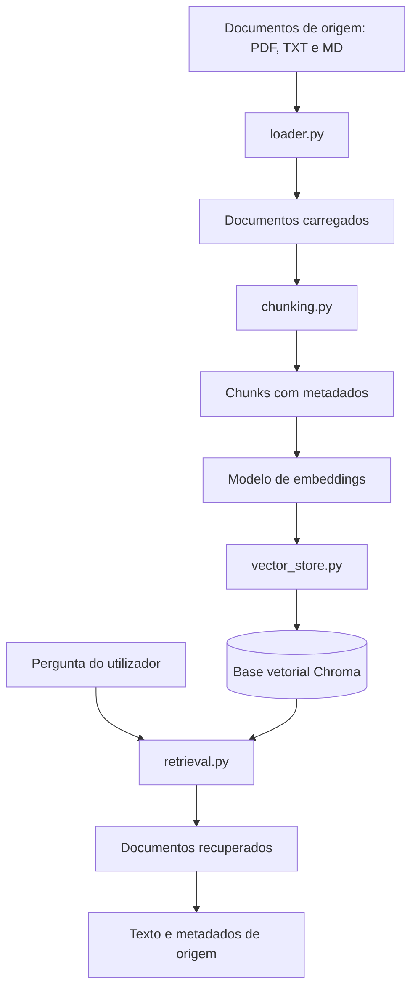

# NovaMente — AI Stack

## 1. Visão Geral

A `ai_stack` é a camada de Inteligência Artificial do ecossistema NovaMente. A sua responsabilidade atual é processar documentos que servem como fonte de conhecimento, preparar o seu conteúdo para pesquisa semântica, armazenar representações vetoriais e recuperar fragmentos relevantes em resposta às perguntas dos utilizadores.

A implementação utiliza as etapas de ingestão e recuperação de uma arquitetura RAG (*Retrieval-Augmented Generation*), recorrendo ao processamento de documentos, à segmentação de texto (*chunking*), aos *embeddings* e à pesquisa por similaridade vetorial.

Nesta fase, o sistema permite ingerir documentos e recuperar informação semanticamente relacionada com uma pergunta. A integração de um Modelo de Linguagem de Grande Escala (LLM) para gerar respostas fundamentadas no contexto recuperado encontra-se prevista para uma etapa posterior.

## 2. Arquitetura dos Módulos

A camada de IA está organizada em módulos com responsabilidades distintas.

### 2.1. `config.py`

**Responsabilidade:** centralizar os principais parâmetros de configuração da aplicação.

Define as seguintes constantes:

- `CHUNK_SIZE`: tamanho máximo configurado para os fragmentos de texto.
- `CHUNK_OVERLAP`: número de caracteres sobrepostos entre fragmentos consecutivos.
- `EMBEDDING_MODEL`: identificador do modelo de embeddings utilizado.
- `RAG_SOURCE_PATH`: caminho para o diretório que contém os documentos de origem.
- `CHROMA_DB_PATH`: caminho para o diretório local de persistência da base de dados vetorial.

Estes parâmetros controlam o processamento dos documentos, a seleção do modelo e os locais de armazenamento.

### 2.2. `ingestion/loader.py`

**Responsabilidade:** carregar os documentos de origem para o pipeline de processamento.

A função `reader()` valida o caminho recebido e a extensão do ficheiro. Em seguida, utiliza o carregador adequado para extrair o conteúdo de documentos PDF, TXT e Markdown.

Os documentos resultantes são representados através da abstração `Document` do LangChain e conservam metadados associados à origem e à página.

### 2.3. `ingestion/chunking.py`

**Responsabilidade:** dividir documentos em fragmentos menores, conhecidos como *chunks*.

A função `chunker()` utiliza o `RecursiveCharacterTextSplitter` com os parâmetros de tamanho e sobreposição definidos na configuração.

O módulo filtra conteúdos vazios e atribui metadados aos fragmentos, incluindo:

- `source`: nome do documento de origem.
- `page`: página associada ao documento.
- `chunk_index`: posição do fragmento no documento processado.
- `chunk_id`: identificador utilizado para localizar e acompanhar o fragmento na base vetorial.

A segmentação permite processar documentos extensos em unidades menores. A sobreposição ajuda a preservar o contexto entre fragmentos consecutivos.

### 2.4. `ingestion/embeddings.py`

**Responsabilidade:** disponibilizar o modelo de embeddings utilizado pelo sistema.

O módulo utiliza `HuggingFaceEmbeddings` com o modelo definido em `EMBEDDING_MODEL`.

O modelo transforma o texto em vetores numéricos que representam características semânticas do conteúdo. Estas representações permitem comparar perguntas e fragmentos de documentos através de medidas de similaridade.

A instância do modelo é mantida em memória durante a execução do processo, permitindo reutilizá-la em chamadas posteriores.

### 2.5. `ingestion/vector_store.py`

**Responsabilidade:** gerir o armazenamento vetorial dos documentos.

O módulo integra o Chroma para armazenar os fragmentos, os respetivos metadados e as suas representações vetoriais.

Antes de inserir novos fragmentos, verifica os identificadores existentes na base de dados. Esta abordagem permite uma ingestão incremental, evitando a reinserção de fragmentos cujos identificadores já se encontram armazenados.

A persistência é configurada através do caminho definido em `CHROMA_DB_PATH`.

### 2.6. `retrieval.py`

**Responsabilidade:** recuperar fragmentos de texto semanticamente relacionados com uma pergunta.

A função `retrieve_context_from_db()` valida os argumentos recebidos e utiliza o método `similarity_search()` do Chroma para recuperar um número definido de documentos semelhantes à pergunta.

A função devolve objetos `Document` do LangChain, contendo o texto recuperado e os respetivos metadados.

A similaridade semântica ajuda a identificar informação relacionada, mas não garante, por si só, que os fragmentos recuperados respondam corretamente à pergunta.

### 2.7. `main.py`

**Responsabilidade:** coordenar o fluxo atual de ingestão e recuperação.

O ponto de entrada executa as seguintes operações:

1. Localiza os ficheiros suportados no diretório configurado.
2. Carrega os documentos através do `loader.py`.
3. Divide o conteúdo em fragmentos através do `chunking.py`.
4. Inicializa o modelo de embeddings.
5. Cria ou atualiza a base de dados vetorial.
6. Executa uma pesquisa de exemplo para testar a recuperação semântica.

Atualmente, o `main.py` funciona como ponto de entrada para executar e verificar as etapas de ingestão e recuperação.

## 3. Fluxo de Dados

O fluxo atual de processamento pode ser representado da seguinte forma:



Durante a ingestão, os fragmentos são convertidos em vetores através da função de embeddings associada ao Chroma e armazenados na base vetorial.

Durante a recuperação, a pergunta é convertida numa representação vetorial compatível com o modelo utilizado. O Chroma pesquisa os vetores armazenados e devolve os fragmentos mais semelhantes, acompanhados dos seus metadados.

A implementação atual termina na recuperação de informação. A geração de respostas com um LLM ainda não está integrada.

## 4. Configuração do Sistema

Os principais parâmetros de configuração encontram-se em `ai_stack/config.py`.

| Parâmetro | Finalidade |
|---|---|
| `CHUNK_SIZE` | Define o tamanho máximo configurado para cada fragmento de texto. |
| `CHUNK_OVERLAP` | Define a sobreposição entre fragmentos consecutivos. |
| `EMBEDDING_MODEL` | Identifica o modelo de embeddings utilizado. |
| `RAG_SOURCE_PATH` | Define o diretório de origem dos documentos. |
| `CHROMA_DB_PATH` | Define o diretório local da base vetorial persistida. |

O caminho de origem deve apontar para um diretório que contenha os documentos destinados à ingestão. É importante evitar a inclusão acidental de ficheiros que não pertençam à fonte de conhecimento do sistema.

Estes parâmetros são constantes de configuração Python, não variáveis de ambiente do sistema operativo.

## 5. Tecnologias Utilizadas

A camada de IA utiliza as seguintes tecnologias:

- **Python:** linguagem utilizada para implementar a lógica de ingestão e recuperação.
- **LangChain:** fornece abstrações para documentos, divisão de texto, integração com embeddings e bases vetoriais.
- **Hugging Face Sentence Transformers:** disponibiliza o modelo de embeddings configurado.
- **Chroma:** armazena representações vetoriais e permite pesquisar documentos por similaridade.
- **PyMuPDF:** permite extrair texto de documentos PDF através do carregador correspondente.

As dependências Python encontram-se declaradas no ficheiro `requirements.txt`. Para conhecer as versões utilizadas no ambiente do projeto, consulta esse ficheiro.

## 6. Instalação

Os comandos seguintes devem ser executados na raiz do repositório NovaMente.

### 6.1. Ativar o ambiente virtual

No PowerShell, executa:

```powershell
.\.venv\Scripts\Activate.ps1
```

Se o ambiente virtual ainda não tiver sido criado, cria-o antes da ativação.

### 6.2. Instalar as dependências

Com o ambiente virtual ativo, executa:

```powershell
python -m pip install -r requirements.txt
```

Na primeira execução, o modelo de embeddings poderá precisar de ser descarregado do Hugging Face. Por isso, poderá ser necessário ter acesso à Internet durante a configuração inicial.

## 7. Como Executar

Com as dependências instaladas e o ambiente virtual ativo, executa o seguinte comando na raiz do repositório:

```powershell
python -m ai_stack.main
```

O ponto de entrada executa a ingestão dos documentos e realiza uma pesquisa de exemplo.

O diretório de origem é definido por `RAG_SOURCE_PATH`, em `ai_stack/config.py`. Antes de executar o pipeline, confirma que o diretório existe e contém documentos com extensões suportadas.

A primeira execução poderá descarregar o modelo de embeddings e processar os documentos de origem. Nas execuções seguintes, o modelo poderá ser reutilizado a partir da cache local, e a base vetorial será consultada no diretório de persistência configurado, de acordo com a lógica atual de ingestão.

## 8. Estado Atual

### 8.1. Funcionalidades implementadas

- Carregamento de documentos PDF, TXT e Markdown.
- Segmentação do conteúdo em fragmentos de texto.
- Preservação de metadados de origem e identificação dos fragmentos.
- Carregamento e reutilização do modelo de embeddings durante a execução.
- Armazenamento de representações vetoriais no Chroma.
- Verificação de identificadores existentes antes da inserção de novos fragmentos.
- Recuperação semântica de documentos através de perguntas.
- Execução do fluxo de ingestão e recuperação através do `main.py`.

### 8.2. Validação realizada

O pipeline foi executado com sucesso e o retriever devolveu fragmentos de documentos acompanhados dos respetivos metadados.

Este resultado confirma que o fluxo básico de execução e recuperação funciona. Contudo, ainda não demonstra a precisão sistemática da recuperação nem garante que todos os fragmentos devolvidos sejam relevantes para as perguntas realizadas.

## 9. Limitações Conhecidas

A implementação atual apresenta as seguintes limitações:

- A relevância da recuperação ainda não foi avaliada sistematicamente através de um conjunto representativo de perguntas.
- A pesquisa por similaridade pode devolver fragmentos pouco relevantes quando a informação disponível não responde adequadamente à pergunta.
- A função de recuperação não gera respostas em linguagem natural.
- A alteração do conteúdo de um documento poderá exigir tratamento adicional se os identificadores dos fragmentos permanecerem iguais.
- O fluxo ainda não foi validado como um serviço completo pronto para produção.

Estas limitações constituem áreas de teste e desenvolvimento para as próximas etapas.

## 10. Próximas Etapas

O desenvolvimento futuro poderá incluir:

1. **Integração de um LLM:** gerar respostas a partir do contexto recuperado.
2. **Preparação do contexto:** organizar os fragmentos e as respetivas fontes antes de os fornecer ao modelo de linguagem.
3. **Avaliação da recuperação:** testar perguntas com resultados relevantes, parcialmente relevantes e sem resposta na base de conhecimento.
4. **Avaliação das respostas:** verificar se as respostas geradas são sustentadas pelos documentos de origem.
5. **Exploração de agentes de IA:** avaliar se agentes especializados são necessários para os requisitos definidos para o projeto.
6. **Preparação para produção:** reforçar os testes automatizados, o tratamento de erros, a observabilidade e os procedimentos de implantação.

A utilização de múltiplos agentes será considerada numa etapa futura, caso os requisitos do projeto justifiquem essa arquitetura. Não faz parte da implementação atual.

---

**NovaMente AI Stack** — ingestão de documentos e recuperação semântica para o ecossistema NovaMente.