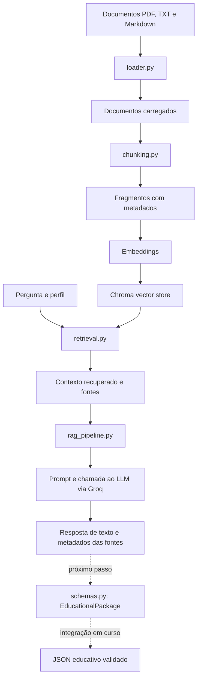

# NovaMente — AI Stack

Camada de Inteligência Artificial do **NovaMente — Sistema Inteligente de Adaptação e Geração de Conteúdo Educacional**, desenvolvido no âmbito do ONE AI FOR TECH.

> **Estado atual:** a AI Stack já dispõe de ingestão de documentos, indexação vetorial, recuperação semântica e geração de respostas com LLM via Groq. Os schemas Pydantic para tutoriais e flashcards têm três testes aprovados. A integração desses schemas na geração estruturada, a persistência no OCI Object Storage e a demonstração end-to-end continuam a ser etapas de desenvolvimento.

## 1. Objetivo

A AI Stack processa documentos técnicos e permite recuperar fragmentos relevantes para uma pergunta. O pipeline RAG utiliza o contexto recuperado para orientar a geração de uma resposta por um modelo de linguagem.

O objetivo do NovaMente é evoluir esse fluxo para produzir conteúdo educativo adaptado ao perfil do estudante e ao formato pedido, incluindo tutoriais e flashcards, com saída estruturada e validada.

## 2. Arquitetura atual

```text
NovaMente/
├── ai_stack/
│   ├── ingestion/
│   │   ├── loader.py
│   │   ├── chunking.py
│   │   ├── embeddings.py
│   │   └── vector_store.py
│   ├── config.py
│   ├── llm.py
│   ├── retrieval.py
│   ├── rag_pipeline.py
│   ├── schemas.py
│   └── main.py
├── backend/
├── docs/
│   └── rag/
│       └── base-de-conhecimento/
├── tests/
│   └── test_schema.py
├── out/
├── requirements.txt
└── .gitignore
```

A árvore representa os módulos relevantes para a AI Stack; a implementação de cada componente pode evoluir durante o desenvolvimento.

### 2.1. `config.py`

Centraliza parâmetros utilizados pelo processamento e pela recuperação, incluindo:

- `CHUNK_SIZE`: tamanho configurado dos fragmentos de texto.
- `CHUNK_OVERLAP`: sobreposição entre fragmentos consecutivos.
- `EMBEDDING_MODEL`: modelo usado para criar embeddings.
- `LLM_MODEL`: identificador do modelo de linguagem utilizado.
- `RAG_SOURCE_PATH`: diretório dos documentos de origem.
- `CHROMA_DB_PATH`: diretório local da base vetorial persistida.

### 2.2. `ingestion/loader.py`

Carrega documentos PDF, TXT e Markdown e converte o conteúdo para objetos `Document` do LangChain, com metadados sobre a fonte e, quando disponível, a página.

### 2.3. `ingestion/chunking.py`

Divide documentos em fragmentos menores através do `RecursiveCharacterTextSplitter`. Os fragmentos mantêm metadados como origem, página, índice e identificador, permitindo rastrear o conteúdo recuperado.

### 2.4. `ingestion/embeddings.py`

Inicializa o modelo de embeddings configurado. Os embeddings convertem texto em vetores numéricos que permitem comparar semanticamente perguntas e fragmentos de documentos.

### 2.5. `ingestion/vector_store.py`

Integra o Chroma para guardar fragmentos, metadados e embeddings. A implementação atual utiliza identificadores dos fragmentos para apoiar a ingestão incremental. Alterações ou remoções de documentos de origem devem ser testadas para garantir que não ficam fragmentos antigos na base vetorial.

### 2.6. `retrieval.py`

A função `retrieve_context_from_db()` valida os argumentos e pesquisa fragmentos semanticamente semelhantes à pergunta. O número de resultados é configurável por `k` — o pipeline atual utiliza `k=3`.

A similaridade não garante, por si só, que os resultados respondam à pergunta. A qualidade da recuperação e a fundamentação das respostas precisam de avaliação com perguntas representativas.

### 2.7. `llm.py`

Encapsula a chamada ao modelo de linguagem através do cliente Groq. A chave de API é carregada da variável `GROQ_API_KEY`, definida localmente no ficheiro `.env`.

### 2.8. `rag_pipeline.py`

Coordena o fluxo RAG atual:

1. Recebe uma pergunta e o perfil educativo.
2. Recupera documentos relevantes do Chroma.
3. Prepara o contexto com o conteúdo e os metadados das fontes.
4. Constrói o prompt com instruções em português e adaptação ao nível do utilizador.
5. Envia as mensagens ao modelo de linguagem através de `llm.py`.
6. Devolve a resposta e os metadados das fontes recuperadas.

O pipeline já gera respostas com LLM, mas **a saída ainda precisa de ser integrada e validada como um `EducationalPackage` estruturado**. A presença de fontes na resposta não é, isoladamente, prova de que todas as afirmações foram fundamentadas pelos excertos recuperados.

### 2.9. `schemas.py`

Define os modelos Pydantic que funcionam como contrato de dados para os conteúdos educativos:

| Modelo | Responsabilidade |
|---|---|
| `EducationMetadata` | Valida perfil, formato, conceitos-chave, tempo estimado de estudo e pré-requisitos. |
| `TutorialStep` | Define uma etapa de tutorial com título, explicação e exemplo opcional. |
| `TutorialContent` | Define o título, a introdução e as etapas de um tutorial. |
| `FlashCard` | Define a frente e o verso de um cartão. |
| `FlashcardContent` | Define o título e a lista de cartões. |
| `EducationalPackage` | Agrupa metadados e conteúdo e valida a compatibilidade entre o formato declarado e o tipo de conteúdo. |

Os modelos suportam atualmente os formatos `tutorial` e `flashcards`, com perfis `iniciante` e `intermediario` nos metadados.

Os testes de schemas usam dados preparados manualmente. Ainda não comprovam que o LLM devolve sempre uma saída válida, nem que o pipeline já produz JSON estruturado em todos os casos.

### 2.10. `main.py`

Ponto de entrada para executar o fluxo de ingestão, indexação, recuperação e demonstração da geração RAG conforme a implementação atual.

## 3. Fluxo de dados



O diagrama distingue o fluxo RAG implementado da integração de saída estruturada que ainda está em curso.

## 4. Tecnologias

- **Python** — lógica de ingestão, recuperação e orquestração.
- **LangChain** — documentos, divisão de texto, prompts e integração de componentes RAG.
- **Hugging Face Sentence Transformers** — modelo de embeddings configurado.
- **Chroma** — armazenamento vetorial local e pesquisa por similaridade.
- **Groq** — acesso ao modelo de linguagem.
- **Pydantic** — validação dos dados dos conteúdos educativos.
- **PyMuPDF** — extração de texto de documentos PDF através do carregador correspondente.
- **pytest** — execução dos testes automatizados.

As dependências e versões encontram-se em `requirements.txt`.

## 5. Instalação e configuração

Executa os comandos a partir da raiz do repositório.

### 5.1. Criar e ativar o ambiente virtual

No PowerShell:

```powershell
python -m venv .venv
.\.venv\Scripts\Activate.ps1
```

### 5.2. Instalar dependências

```powershell
python -m pip install -r requirements.txt
```

### 5.3. Configurar a chave da Groq

Cria um ficheiro `.env` na raiz do projeto e define a variável:

```dotenv
GROQ_API_KEY=coloca_a_tua_chave_aqui
```

Substitui o valor de exemplo pela tua chave. **Não partilhes a chave e não incluas o `.env` no Git.** Confirma que `.env` consta do `.gitignore`.

Na primeira utilização, o modelo de embeddings poderá precisar de ser descarregado do Hugging Face, pelo que pode ser necessária ligação à Internet.

## 6. Executar

Com o ambiente virtual ativo, na raiz do repositório:

```powershell
python -m ai_stack.main
```

A execução segue o fluxo implementado em `main.py`, incluindo as operações de ingestão/indexação e a demonstração de recuperação e geração. O tempo da primeira execução pode ser superior devido ao carregamento inicial do modelo de embeddings.

Os documentos destinados à base de conhecimento devem estar no diretório configurado por `RAG_SOURCE_PATH`. O armazenamento vetorial local é definido por `CHROMA_DB_PATH`.

## 7. Testes automatizados

Executa os testes dos schemas com:

```powershell
python -m pytest tests/test_schema.py -v
```

### Testes atuais

- `test_flashcard`: verifica a validação de um pacote de flashcards e o tipo do conteúdo.
- `test_tutorial`: verifica a validação de um pacote de tutorial e o tipo do conteúdo.
- `test_formato_incompativel`: verifica que uma combinação entre formato declarado e tipo de conteúdo incompatível é rejeitada.

**Último resultado observado no ambiente de desenvolvimento:** `3 passed`.

Estes testes cobrem os schemas; não constituem uma avaliação completa da recuperação, da qualidade das respostas do LLM, da API ou do armazenamento remoto.

## 8. Estado de implementação

### Implementado e verificado

- Carregamento de documentos PDF, TXT e Markdown.
- Segmentação em fragmentos com metadados.
- Geração de embeddings e armazenamento vetorial local no Chroma.
- Recuperação semântica de fragmentos.
- Chamada a um LLM através da Groq para geração de respostas no fluxo RAG.
- Schemas Pydantic para os formatos tutorial e flashcards.
- Três testes automatizados dos schemas aprovados.

### Em desenvolvimento / por validar

- Integração de `EducationalPackage` no pipeline de geração.
- Geração de saída JSON estruturada de forma consistente para os dois formatos.
- Avaliação sistemática da relevância dos fragmentos recuperados e da fundamentação das respostas.
- Persistência dos documentos originais e dos JSON gerados no **OCI Object Storage Always Free**, conforme os requisitos do hackathon.
- Integração end-to-end com a API e/ou interface de demonstração.
- Preparação e validação dos três cenários de demonstração e da documentação final de arquitetura.

## 9. Limitações conhecidas

- A pesquisa por similaridade pode devolver fragmentos relacionados, mas insuficientes para responder à pergunta.
- A fundamentação de cada afirmação gerada ainda precisa de testes específicos com perguntas e respostas de referência.
- O modelo de embeddings configurado deve ser avaliado com documentos e perguntas em português; a adequação linguística não deve ser presumida apenas porque o modelo funciona tecnicamente.
- A ingestão incremental deve ser verificada quando documentos são alterados ou removidos, para evitar fragmentos desatualizados.
- A geração de respostas RAG e a validação dos schemas já foram verificadas separadamente, mas o fluxo integrado de geração de JSON ainda precisa de validação.
- A persistência no OCI Object Storage e o fluxo completo pronto para demonstração ainda não estão assinalados como concluídos.

## 10. Próximas prioridades

1. Integrar `EducationalPackage.model_validate()` no fluxo de geração e tratar respostas inválidas do LLM.
2. Testar a geração de tutorial e flashcards através do pipeline real, não apenas com dados preparados manualmente.
3. Avaliar a recuperação e confirmar que as respostas estão fundamentadas nas fontes devolvidas.
4. Implementar e testar a persistência de documentos originais e resultados JSON no OCI Object Storage.
5. Fechar a integração com a API/interface e executar os três cenários de demonstração.
6. Considerar uma arquitetura multiagente apenas se houver tempo e se esta resolver uma necessidade comprovada do MVP.

A prioridade é garantir um fluxo end-to-end fiável antes de acrescentar complexidade arquitetural.

---

**NovaMente AI Stack** — ingestão documental, recuperação semântica e geração assistida de conteúdo educativo.