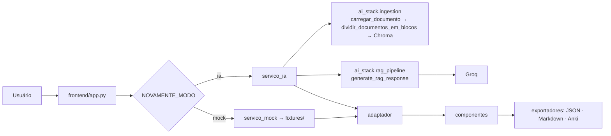

# NovaMente — Frontend (Streamlit)

Interface interativa do NovaMente: o usuário envia um documento técnico (PDF, Markdown ou TXT),
informa o tema, escolhe **perfil** e **formato**, e recebe flashcards, quiz ou tutorial gerados pela
`ai_stack` a partir dos trechos do documento — com o relatório do agente revisor e as fontes usadas.



## Como rodar

Sempre a partir da **raiz do repositório**.

### Modo demonstração (sem IA, sem modelo pesado)

```powershell
python -m venv .venv
.\.venv\Scripts\Activate.ps1
python -m pip install -r frontend/requirements.txt
copy frontend\.env.example frontend\.env
streamlit run frontend/app.py
```

As respostas vêm de `frontend/fixtures/`. Digite um tema com a palavra "nada" para ver a tela de
"tema não encontrado".

### Modo IA (ai_stack real)

1. Instale também as dependências da raiz: `python -m pip install -r requirements.txt` (inclui torch).
2. Coloque `GROQ_API_KEY=...` em um `.env` na raiz do repositório.
3. Indexe a base de conhecimento uma vez: `python -m ai_stack.main`.
4. Em `frontend/.env`: `NOVAMENTE_MODO=ia`.
5. `streamlit run frontend/app.py`.

Sem upload, a busca usa a base já indexada (guia de Power BI). Com upload, o arquivo é salvo em
`data/uploads/` e indexado no mesmo Chroma.

### Testes

```powershell
cd frontend
python -m pytest
```

## Estrutura

```
frontend/
├── app.py                    # layout, fluxo principal, tratamento de erros
├── src/
│   ├── config.py             # modo, caminhos, opções dos menus, cenários de demo
│   ├── modelos.py            # dataclasses usadas pela tela
│   ├── adaptador.py          # retorno da ai_stack → modelos internos
│   ├── servico.py            # protocolo ServicoConteudo + ErroServico
│   ├── servico_mock.py       # fixtures (desenvolvimento/demo)
│   ├── servico_ia.py         # ÚNICO módulo que importa ai_stack
│   ├── exportadores.py       # JSON (enunciado), Markdown, CSV Anki — funções puras
│   └── componentes/          # formulário, flashcards, quiz, tutorial, metadados, qualidade, exportar
├── fixtures/                 # respostas de exemplo no formato de gerar_resposta_rag
├── tests/
├── .streamlit/config.toml    # tema e limite de upload
└── .env.example
```

## O que a tela oferece hoje

- Perfis: Iniciante, Intermediário · Formatos: Flashcards, Quiz, Tutorial — exatamente o que a
  `ai_stack` aceita (`ai_stack/schemas.py`). Novos perfis/formatos: acrescentar em `src/config.py`.
- Quiz com **feedback imediato** e placar; flashcards com "virar"; tutorial em passos.
- Aba **Qualidade e fontes**: status do agente revisor, problemas apontados, arquivos e páginas usados.
- Aba **Exportar**: JSON no formato do enunciado, Markdown e CSV para Anki.
- **Cenários de demonstração**: três botões que adaptam o mesmo documento para perfis/formatos diferentes.

## Pendências conhecidas

- **OCI Object Storage** (obrigatório no enunciado) ainda não é chamado por ninguém: o JSON exportado
  traz `"armazenamento_oci": {"status_upload": "nao_configurado"}`. Definir com o time onde o upload
  para o bucket acontece.
- A busca do `rag_pipeline` não filtra por documento: um upload novo é indexado junto da base de
  Power BI e a recuperação pode misturar fontes. Precisa de filtro por `document_id` na `ai_stack`.
